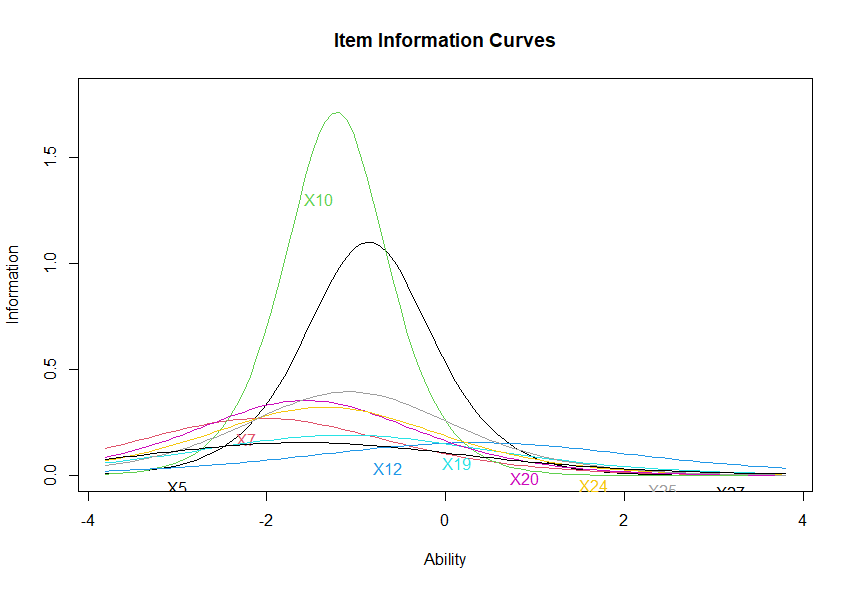
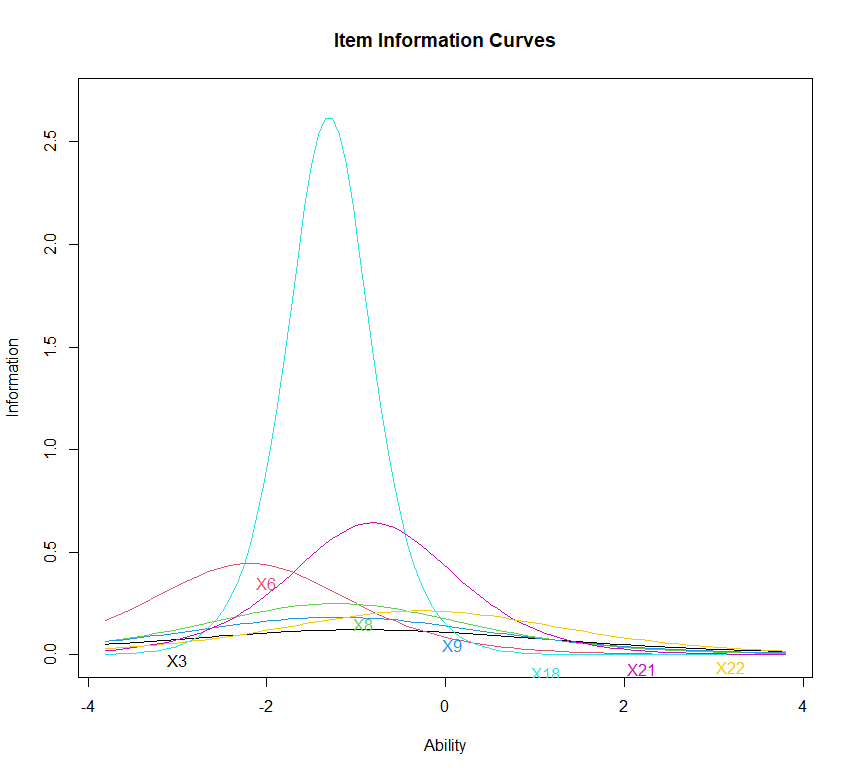
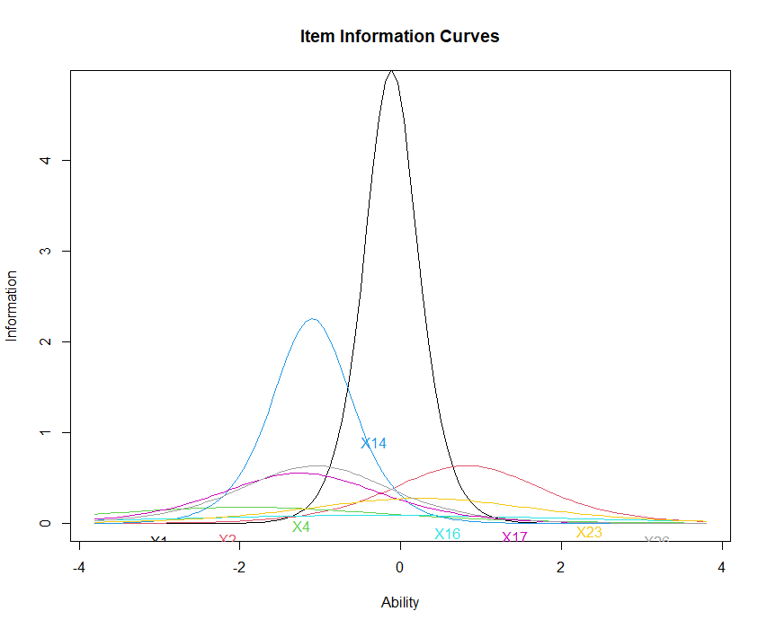
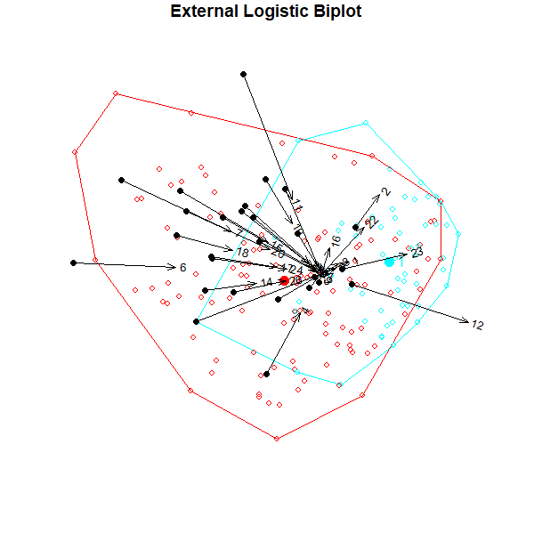
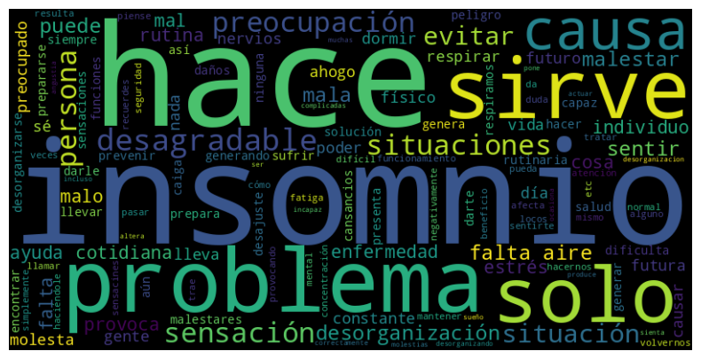
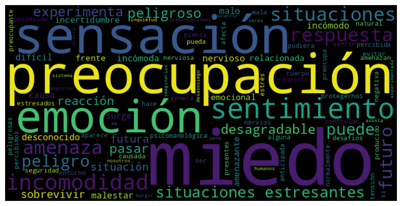
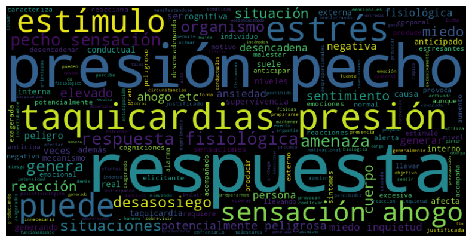

# Design and validation of two anxiety knowledge questionnaires

Master's Thesis in Advanced Multivariate Data Analysis and Big Data | University of Salamanca | 2022–2023

**Authors:** Eduardo Galván Vidal and Pablo Pérez Vargas

**Supervisors:** Mercedes Sánchez Barba and María Cortés Rodríguez

## Overview

This thesis presents the design and assessment of two questionnaires for measuring anxiety knowledge: a 27-item multiple-choice test and a six-question open-ended questionnaire.

The work focuses on the knowledge used in psychoeducation: understanding the function of anxiety, recognising its symptoms and knowing which responses and coping strategies are useful. We wanted to identify what people already knew and which topics needed more attention during an intervention.

The first study examined the multiple-choice questionnaire through group comparisons, factor analysis, internal consistency, Item Response Theory (IRT), an external logistic biplot and differential item functioning. The second study combined synthetic response generation, text analysis, word embeddings and recurrent neural networks to classify open-ended answers by knowledge level.

[Read the complete thesis](thesis/thesis.pdf) (in Spanish).

## Research question and aim

The aim was to develop two tools for measuring anxiety knowledge and to study their use in evaluating psychoeducation. We also examined differences in knowledge and perceived anxiety according to gender, education and health training.

The thesis distinguishes **anxiety knowledge** from **perceived anxiety**. The first concerns what a person understands about anxiety and its management. The second concerns how much anxiety that person reports experiencing. The questionnaires were designed around the first of these, with perceived anxiety included as a separate measure.

## Study 1. Multiple-choice questionnaire

### Questionnaire design

The 27 questions covered general knowledge and the three components of Lang's anxiety response model: physiological, cognitive and behavioural. Within these sections, we considered four content categories.

| Content category | What the questions assessed |
|---|---|
| Relaxation techniques and coping strategies | Knowledge of methods for reducing symptoms and managing situations that cause anxiety |
| Recognition of anxiety symptoms | Identification of physiological, cognitive and behavioural symptoms |
| Anxiety incubation theory | Knowledge of the effects of avoidance and confrontation over time |
| Anxiety as a necessary response | Understanding the adaptive function of anxiety and its role in preparing the person to act |

The questions were written around knowledge that could be useful in daily life and psychological treatment. For example, we asked whether anxiety is necessary, which strategies help reduce physiological symptoms and whether avoiding a situation affects the anxiety response in the long term.

### Sample and descriptive results

The participants section describes **172 adults: 56 men and 116 women**. Responses were collected through Google Forms, distributed through social media and University of Salamanca emails. Participation required being an adult, living in Spain, accepting informed consent and not completing the open-ended questionnaire.

Most participants had higher education, and approximately 35% were described as psychologists. Age, gender, education and field of study were recorded alongside the questionnaire answers. Perceived anxiety was measured with one question scored from 1 to 10.

| Variable | Mean | SD |
|---|---:|---:|
| Age | 27.94 | 9.24 |
| Perceived anxiety | 5.81 | 2.18 |
| Anxiety knowledge, out of 27 | 19.31 | 4.71 |

The mean knowledge score suggested that many questions were relatively easy. We then examined whether this result differed between groups.

### Differences between groups

Normality checks led to the use of Kruskal–Wallis tests for the main group comparisons.

**Women obtained higher knowledge scores and reported higher perceived anxiety.** Both differences were significant. **Knowledge scores also differed by education**, with the postgraduate group obtaining the highest mean score. The perceived anxiety plots did not show a clear difference between education groups.

**The health group obtained higher knowledge scores than the non-health group.** This comparison included psychology, nursing and medicine. Perceived anxiety did not differ significantly between the two groups.

The interaction analyses followed the same pattern. For knowledge, education, gender and group were significant, while their interactions were not. For perceived anxiety, only gender was significant, **F = 9.873, p = .002**. The education-by-gender interaction was not significant, **p = .214**.

### Exploratory factor analysis

The parallel analysis in the thesis supported retaining **three factors**. Together, they explained **39.3% of the variance**.

| Factor | Interpretation | Variance explained |
|---|---|---:|
| 1 | Coping techniques, strategies and the effects of avoidance | 14.5% |
| 2 | More theoretical or formal knowledge of anxiety | 14.2% |
| 3 | Practical knowledge, particularly recognising and distinguishing symptoms | 10.5% |

The first factor brought together relaxation techniques and anxiety incubation theory. We interpreted this combination through the relationship between coping and avoidance: the questions concerned how to face anxiety and what happens when situations are repeatedly avoided.

The second factor was harder to interpret. It included questions about concepts such as physiological activation and metacognition, but some questions also concerned practical knowledge or loaded on another factor. The third factor had a clearer relationship with recognising symptoms and understanding anxiety through everyday experience.

We used a loading of **.35** as a reference when reviewing the questions. **X11, X13, X15, X21, X23 and X24** were identified as problematic because of weak or unclear contributions. X11, X13 and X15 did not provide sufficient information about any of the three factors.

The complete loading table is included in [Table 9](tables/original/table_09_efa_loadings.csv).

### Internal consistency

The complete questionnaire obtained **Cronbach's alpha = .81**. The standardised alpha was also **.81**, the Guttman coefficient was **.84**, and the signal-to-noise ratio was **4.37**.

| Item set | Cronbach's alpha | Standardised alpha | Guttman coefficient |
|---|---:|---:|---:|
| Complete questionnaire | .81 | .81 | .84 |
| Factor 1 | .73 | .74 | .74 |
| Factor 2 | .59 | .60 | .58 |
| Factor 3 | .70 | .70 | .70 |

The lower consistency of Factor 2 agreed with the difficulties found in the exploratory analysis. Its questions did not describe a sufficiently clear and consistent area of knowledge.

### Item Response Theory: difficulty and item information

The IRT analysis, presented in the thesis under the Rasch model, examined each factor separately. We studied the information provided by each question across different levels of anxiety knowledge and compared this with its factor loading.

**The curves were mainly located at low ability levels.** Many questions could therefore be answered correctly with relatively little knowledge. This reduced their usefulness for distinguishing participants with higher knowledge levels.

For **Factor 1**, the reported total information was **11.81** across nine questions. Dividing this by nine gave a reference value of **1.31** per question. **X12, X19 and X27** provided the least information and also had relatively low factor loadings. Questions within .30 points below the reference value were retained when their content was relevant to the factor.

For **Factor 2**, more questions provided little information. **X18, the question about metacognition, accounted for much of the factor's information**, but its relevance to the intended knowledge measure was questioned. We considered that the distinction between metacognition and anxiety might be unclear to participants without formal psychology training. This question was removed in the later reduced confirmatory model.

For **Factor 3**, **X1 and X14** provided most of the information. These concerned the definition of anxiety and the identification of a cognitive symptom. The interpretation of X1 was particularly useful: its answer options included an anxiety attack and a mental disorder, two concepts that can be confused with anxiety in everyday language.

<table>
  <tr>
    <th>Factor 1</th>
    <th>Factor 2</th>
    <th>Factor 3</th>
  </tr>
  <tr>
    <td><a href="thesis/figures/figure_13_curves.png"></a></td>
    <td><a href="thesis/figures/figure_14_curves.png"></a></td>
    <td><a href="thesis/figures/figure_15_curves.png"></a></td>
  </tr>
</table>

*Figures 13–15. Original item information curves.*

### External logistic biplot

The biplot examined the position of participants according to their answer patterns and the questions associated with the differences between groups. The health group generally occupied the area with higher scores and a higher probability of answering correctly.

Questions **X11, X13 and X15** contributed little to this distinction. Questions **X6–X9** also had low Nagelkerke values, despite some acceptable factor loadings. Many participants answered them correctly, which limited their ability to distinguish knowledge levels.

**X12 illustrated a different problem:** it was often answered incorrectly, but it still had little discriminating value. A difficult question was therefore not necessarily a useful question for measuring anxiety knowledge.



*Figure 16. Health group in blue and non-health group in red.*

### Differential item functioning: DFIT

We used DFIT to examine whether questions functioned differently between groups at a given ability level. The analysis included item-level **NCDIF** and factor-level **DTF**, with an NCDIF reference value of **.024**.

Most questions in Factor 1, all but one in Factor 2 and all questions in Factor 3 exceeded this value. The DTF results also exceeded the reference values for all three factors.

| Factor | Critical value | DTF |
|---|---:|---:|
| 1 | .216 | 2.509 |
| 2 | .168 | 3.034 |
| 3 | .192 | 5.297 |

The thesis interpreted these results alongside the biplot as evidence of differences in questionnaire functioning between participants with and without health training. Questions X1 and X2 were particularly relevant in both analyses.

### Confirmatory factor analysis

The complete confirmatory model followed the questionnaire's theoretical content categories, combining relaxation techniques with anxiety incubation theory. The other two categories concerned symptom identification and anxiety as a necessary response.

This complete model had a poor fit. We then assessed a reduced model after removing six questions: five considered problematic and X18, the metacognition question.

| Model | CFI | TLI | Chi-squared test p |
|---|---:|---:|---:|
| Complete | .807 | .789 | < .05 |
| Reduced | .964 | .959 | .199 |

The reduced model showed a considerable improvement. Together with the factor loadings and item information curves, this result supported revising the questions before collecting a new sample.

## Study 2. Open-ended questionnaire, text analysis and deep learning

### Questionnaire design

The second questionnaire used six open-ended questions. Three addressed general knowledge and three covered the physiological, cognitive and behavioural components of anxiety.

| Question | Content |
|---|---|
| R1 | What is anxiety? |
| R2 | What function does anxiety serve for the individual? |
| R3 | What is the most effective way to prevent anxiety disorders? |
| R4 | What is physiological activation and how is it related to anxiety? |
| R5 | What role do personal beliefs and experiences play in anxiety? |
| R6 | How do you act to control your response in a situation of anxiety? |

The aim was to classify the written answers into **low, medium or high anxiety knowledge**. This required analysing the content of each answer, rather than assigning a score from a fixed set of options.

### Synthetic response generation

Only **15 people** completed this questionnaire. We therefore used their answers as examples for generating additional responses with **Davinci-003** through the OpenAI API.

Prompts were prepared for each question and knowledge level. For R1, for example, the prompt included four human examples of low knowledge, six of medium knowledge and four of high knowledge. The temperature was set to **1** to obtain more varied responses.

We generated **100 responses per question**, with **25% low**, **50% medium** and **25% high** knowledge. This formed the dataset used for the text classification study. The thesis examined this use of language models as a form of **data augmentation** when few human responses were available.

### Text preprocessing and neural networks

The written answers were converted into numerical representations using **word embeddings**. We then tested recurrent neural networks (**RNN**) and **long short-term memory networks (LSTM)**. LSTM gave better results and was selected for the final model.

The model was trained and assessed separately for each question, so that it could learn the content relevant to that particular answer. The final architecture contained six layers.

| Layer | Configuration | Parameters |
|---|---|---:|
| Embedding | Sequences of 22 tokens; 512 values per token | 5,120,000 |
| First LSTM | 128 units; output retained across the sequence | 328,192 |
| Dropout | 20% | 0 |
| Second LSTM | 64 units | 49,408 |
| Dense | 32 units | 2,080 |
| Output | 3 units with softmax, one per knowledge level | 99 |
| **Total** | | **5,499,779** |

Dropout was included to reduce overfitting. The output layer returned a probability for each of the three knowledge levels, and the class with the highest probability was selected as the prediction.

### Word clouds and differences in answer content

We examined word frequencies to interpret differences between the knowledge levels. The word clouds for R1 showed three different ways of describing anxiety.

**Low-knowledge answers** focused on problems and negative consequences, including insomnia. **Medium-knowledge answers** described anxiety as a sensation, emotion or feeling of fear in response to a threat. **High-knowledge answers** more often used terms such as response and stimulus, together with specific symptoms. They also showed less confusion between anxiety and related concepts.

<table>
  <tr>
    <th>Low knowledge</th>
    <th>Medium knowledge</th>
    <th>High knowledge</th>
  </tr>
  <tr>
    <td><a href="thesis/figures/figure_17.png"></a></td>
    <td><a href="thesis/figures/figure_18.png"></a></td>
    <td><a href="thesis/figures/figure_19.png"></a></td>
  </tr>
</table>

*Figures 17–19. Word clouds for R1, preserving the original Spanish answers.*

### Classification results

The model's accuracy varied by question. It was highest for R3 on generated responses and for R5 on human responses. The thesis reported an average accuracy of **77% on generated responses** and **50% on the original human responses**.

| Question | Test loss on generated responses | Accuracy on generated responses | Accuracy on human responses |
|---|---:|---:|---:|
| R1 | .58 | 69% | 40% |
| R2 | .41 | 89% | 46% |
| R3 | .70 | 93% | 53% |
| R4 | .90 | 84% | 53% |
| R5 | .73 | 66% | 66% |
| R6 | .99 | 65% | 40% |
| **Reported mean** | **.73** | **77%** | **50%** |

When applied to human answers, the model tended to predict **medium knowledge**, the category with twice as many generated examples as either of the other categories. In the detailed predictions for R1, low-knowledge human answers were particularly difficult to identify.

The discussion linked these results to the small dataset, the unequal class sizes and the quality of the prompts and examples used to generate responses. The differences between generated and human answers were central to the interpretation of the model's results.

## Discussion and conclusions

The multiple-choice study showed that anxiety knowledge could be assessed through questions about its function, symptoms and management. The different analyses also helped identify which questions needed revision. Factor analysis described the questionnaire's structure, IRT examined difficulty and information, and the biplot and DFIT examined differences between groups.

The sample contained many participants with higher education and health training. The thesis proposed improving the weaker questions and collecting a larger sample with more non-health participants before repeating the analyses.

The open-ended study explored the use of language models to generate additional responses and deep learning to classify written answers. Its results showed the importance of the examples used in generation and of assessing the model with human answers. The proposed next steps were to obtain more human responses, improve the generation prompts and increase the amount of training data.

Both studies concerned the same practical aim: identifying what a person knows about anxiety so that psychoeducation can address the topics that are least understood.

## Thesis and repository materials

The [submitted PDF](thesis/thesis.pdf) and [Word document](thesis/thesis.docx) contain the complete theoretical framework, methods, results and discussion. The figures shown above and the values in this summary come from that work.

```text
data/                 Scored multiple-choice responses and item descriptions
R/                    Data preparation and analysis scripts
figures/reproduced/   Figures generated by R
tables/original/      Original thesis results, with English labels
tables/reproduced/    Results calculated from the recovered data
thesis/               Submitted documents and original figures
docs/                 Analysis settings and comparisons
```

To run the R analyses:

```bash
Rscript R/install_packages.R
Rscript R/analysis.R
```

The recovered multiple-choice file contains 174 records. The [comparison table](tables/reproduced/comparison_with_thesis.csv) and [analysis notes](docs/analysis_notes.md) record which recalculated results match the thesis and where differences remain. The open-ended response data have not been recovered; its original results and model architecture are retained in the repository.

## Citation

Galván Vidal, E., & Pérez Vargas, P. (2023). *Design and validation of two anxiety knowledge questionnaires for the study of the relationship between knowledge and perceived anxiety*. Master's thesis, University of Salamanca.
